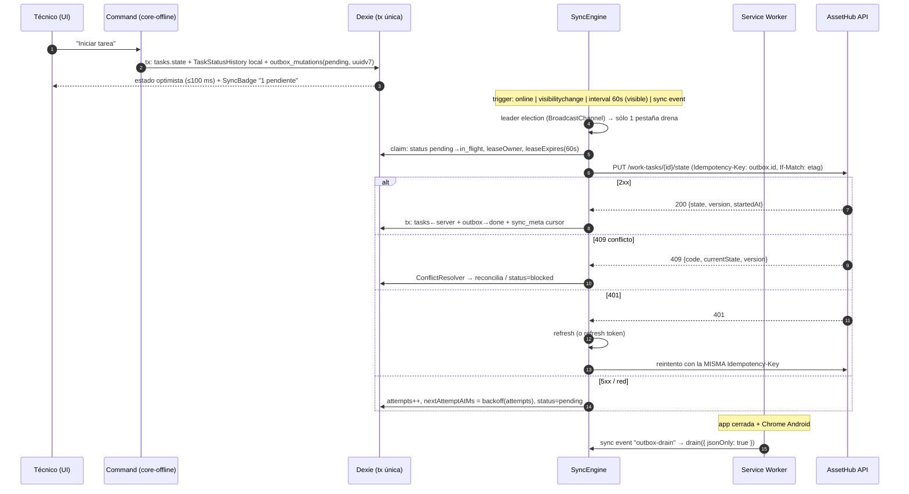

# Plan de implementación: `field-pwa` (PWA Offline-First de campo)

**Branch**: `021-pwa-field-app`
**Fecha**: 2026-10-28
**Spec**: `specs/021-pwa-field-app/spec.md`
**Tareas**: `specs/021-pwa-field-app/tasks.md`
**Estado**: Diseño V1 — bloqueado por B1–B9, especificados en `specs/022-field-sync-backend/` (Fase 0)

---

## 1. Resumen ejecutivo

Se agrega una segunda aplicación al monorepo frontend (`apps/field-pwa`) y un paquete transversal (`packages/core-offline`). La app **no habla con la API desde la UI**: lee de IndexedDB vía repositorios tipados y escribe en IndexedDB + outbox dentro de una única transacción Dexie. Un motor de sincronización independiente del framework drena el outbox con idempotencia (UUIDv7), backoff exponencial y política de conflictos explícita por recurso.

Decisiones estructurales clave (detalle en §7 del spec y en las ADR de este documento):

1. **Una sola caché**: Dexie es la única fuente de verdad local. Workbox **no** cachea respuestas de API (§8.2).
2. **`core-offline` sin DOM**: mismo código corre en la app y en el service worker (§4).
3. **Idempotencia por mutación, no por intento** (§6.5).
4. **Conflictos por `ETag`/`If-Match`**, no por timestamps (§6.6).
5. **Lease offline firmado por el servidor** (§7).

---

## 2. Contexto técnico

**Verificado en el repo el 2026-10-28** (no inferido):

| Aspecto | Valor real |
| :--- | :--- |
| Workspace | `pnpm@9.15.9`, `pnpm-workspace.yaml` → `apps/*`, `packages/*` (ya cubre las rutas nuevas) |
| App admin | `asset-hub/src/frontend/apps/web` — React `^19.3.0`, Vite `^6.0.7`, TS `~5.7.2`, Tailwind `^4.0.0` |
| UI compartida | `@asset-hub/ui` (workspace:*, exports `./src/index.ts` y `./src/styles/globals.css`) |
| RJSF | `@rjsf/core`, `@rjsf/utils`, `@rjsf/validator-ajv8` en `^6.7.1` (API v6) |
| Router / data | `@tanstack/react-router ^1.170.18`, `@tanstack/react-query ^5.101.4`, `zustand ^5.0.2` |
| Estado actual del dominio | `WorkTask` sin `RowVersion`/`UpdatedAt`; `StockBalance` con `RowVersion`; `TaskEvidence` con `type`/`blobUri` |
| Auth | `POST /api/v1/auth/login` → `LoginResult(AccessToken, RefreshToken, ExpiresIn = 900, …)`; `POST /refresh` con rotación |
| Rutas API relevantes | `api/v1/work-tasks`, `api/v1/assets`, `api/v1/incidents`, `api/v1/inventory`, `api/v1/media`, `api/v1/auth` |
| Constitución | `.specify/memory/constitution.md` es plantilla vacía → no hay gates formales; se aplican convenciones del repo |

**Dependencias nuevas a agregar** (en `field-pwa` o `core-offline` según corresponda):

| Paquete | Versión objetivo | Uso |
| :--- | :--- | :--- |
| `dexie` | `^4.2` | Persistencia IndexedDB tipada |
| `dexie-react-hooks` | `^1.1` | `useLiveQuery` en la capa UI |
| `vite-plugin-pwa` | `^1.0` | `injectManifest` + Workbox |
| `workbox-precaching`, `workbox-routing`, `workbox-strategies`, `workbox-expiration`, `workbox-core` | `^7` | Estrategias del SW |
| `@zxing/browser` | `^0.1` | Fallback de escaneo (iOS) |
| `browser-image-compression` | `^2` | Compresión de fotos (o `createImageBitmap` + canvas propio) |
| `idb-keyval` | — | **No usar**: Dexie cubre el caso |
| `vitest`, `fake-indexeddb`, `msw`, `@playwright/test`, `jest-axe` | latest | Testing (dev) |

> `browser-image-compression` es opcional: si se implementa compresión propia con `createImageBitmap` + `OffscreenCanvas` (recomendado para control de EXIF y workers), se evita la dependencia.

---

## 3. Arquitectura del cliente

### 3.1 Diagrama de capas

```text
┌──────────────────────────────────────────────────────────────────────────────┐
│ L1 · UI (apps/field-pwa)                                                     │
│  Rutas (TanStack Router) · Pantallas · Componentes de dominio                │
│  Consume @asset-hub/ui (Radix+Tailwind). NUNCA importa axios/fetch.          │
└───────────────┬──────────────────────────────────────────┬───────────────────┘
                │ hooks de lectura (useLiveQuery)          │ comandos
┌───────────────▼──────────────────────────────────────────▼───────────────────┐
│ L2 · Application hooks (apps/field-pwa/src/features/*/hooks)                 │
│  useTasks() · useTaskActions() · useIncidents() · useAssetLookup()           │
│  Zustand: sessionStore, syncStore, uiStore (efímero, no persistido)          │
└───────────────┬──────────────────────────────────────────┬───────────────────┘
                │                                          │
┌───────────────▼──────────────────────────────────────────▼───────────────────┐
│ L3 · Repositorios + comandos (packages/core-offline)                        │
│  TaskRepository · IncidentRepository · AssetRepository · StockRepository    │
│  + Commands: startTask(), completeTask(), reportIncident(), consumeMaterial()│
│  Regla: comando = 1 transacción Dexie que escribe dominio + outbox           │
└───────────────┬──────────────────────────────────────────┬───────────────────┘
                │                                          │
┌───────────────▼──────────────────┐   ┌───────────────────▼───────────────────┐
│ L4 · Dexie DB                    │   │ L4' · Sync Engine                    │
│  tasks, assets, incidents,       │◄──┤  OutboxDrainer · BackoffPolicy       │
│  materials_stock,                │   │  ConflictResolver · MediaUploader    │
│  outbox_mutations, media_queue,  │   │  PullSyncer · LeaderElection         │
│  sync_meta, auth_session         │   │  (sin React, sin DOM)                │
└──────────────────────────────────┘   └───────────────────┬───────────────────┘
                                                           │ fetch + headers
┌──────────────────────────────────────────────────────────▼───────────────────┐
│ L5 · Transport (core-offline/transport)                                      │
│  HttpClient (fetch nativo) · AuthInterceptor · Retry-After · ClockSkew        │
└──────────────────────────────────────────────────────────┬───────────────────┘
                                                           │
┌──────────────────────────────────────────────────────────▼───────────────────┐
│ L6 · Service Worker (apps/field-pwa/src/sw.ts)                               │
│  Precaching app shell · rutas de estáticos/media · sync/periodicsync         │
│  Importa OutboxDrainer de core-offline (modo JSON-only)                      │
└──────────────────────────────────────────────────────────────────────────────┘
```

**Regla de dependencia (unidireccional, verificable por lint):**

```text
UI → hooks → core-offline → Dexie / fetch
SW → core-offline
core-offline ⇏ React, ⇏ @asset-hub/ui, ⇏ apps/*
```

`core-offline` tiene **cero** dependencias de React. Es la condición para poder ejecutarlo en el SW (§8.4).

### 3.2 Responsabilidades por capa

| Capa | Responsabilidad | Prohibido |
| :--- | :--- | :--- |
| L1 UI | Render, accesibilidad, gestos, feedback | Fetch, lógica de reintentos, leer `localStorage` |
| L2 Hooks/Stores | Adaptar repositorios a React; estado efímero de UI | Persistir datos de dominio |
| L3 Repositorios | Invariantes de dominio, transacciones, encolado | Conocer React o el router |
| L4 Dexie | Persistencia, índices, migraciones | Contener reglas de negocio |
| L4' Sync | Orden, backoff, idempotencia, conflictos | Tocar el DOM o mostrar toasts |
| L5 Transport | HTTP, headers, skew, 401 | Decidir qué hacer ante un conflicto |
| L6 SW | Assets estáticos, wake-up del drenado | Cachear respuestas de API |

### 3.3 Estructura de carpetas

```text
asset-hub/src/frontend/
├── apps/
│   ├── web/                                  # sin cambios
│   └── field-pwa/
│       ├── index.html
│       ├── vite.config.ts                    # VitePWA(injectManifest) + tailwind
│       ├── tsconfig.json
│       ├── package.json                      # name: "field-pwa"
│       ├── public/
│       │   ├── manifest.webmanifest
│       │   └── icons/ (192, 512, maskable)
│       └── src/
│           ├── main.tsx
│           ├── app/
│           │   ├── router.tsx
│           │   ├── providers.tsx             # QueryClient, SyncProvider, Theme
│           │   └── guards.tsx                # RequireSession, RequireLease
│           ├── routes/
│           │   ├── __root.tsx                # AppShell + TabBar + SyncChip
│           │   ├── index.tsx                 # "Mi jornada"
│           │   ├── tasks.$taskId.tsx
│           │   ├── incidents.new.tsx
│           │   ├── assets.index.tsx
│           │   ├── assets.$assetId.tsx
│           │   ├── scan.tsx
│           │   ├── stock.tsx
│           │   └── sync.tsx                  # detalle del outbox
│           ├── features/
│           │   ├── tasks/{hooks,components}
│           │   ├── incidents/{hooks,components,camera}
│           │   ├── assets/{hooks,components,scanner}
│           │   ├── inventory/{hooks,components}
│           │   ├── auth/{hooks,components}
│           │   └── sync/{hooks,components}
│           ├── shared/
│           │   ├── components/               # composiciones de campo (no primitivos)
│           │   ├── lib/{geo.ts,time.ts,image.ts}
│           │   └── i18n/es.json
│           └── sw.ts
└── packages/
    ├── ui/                                   # + BottomSheet, TabBar, TapTarget, SyncBadge
    └── core-offline/
        ├── package.json                      # name: "@asset-hub/core-offline"
        ├── tsconfig.json
        └── src/
            ├── index.ts
            ├── db/
            │   ├── schema.ts                 # interfaces de registro
            │   ├── database.ts               # clase FieldDatabase + versiones
            │   └── migrations.ts
            ├── repositories/
            │   ├── task.repository.ts
            │   ├── asset.repository.ts
            │   ├── incident.repository.ts
            │   ├── stock.repository.ts
            │   └── sync-meta.repository.ts
            ├── commands/
            │   ├── start-task.ts
            │   ├── pause-task.ts
            │   ├── complete-task.ts
            │   ├── save-checklist.ts
            │   ├── report-incident.ts
            │   ├── attach-media.ts
            │   └── consume-material.ts
            ├── outbox/
            │   ├── outbox.ts                 # enqueue (dentro de tx)
            │   ├── drainer.ts
            │   ├── backoff.ts
            │   ├── coalesce.ts
            │   ├── conflicts.ts
            │   └── leader.ts                 # BroadcastChannel
            ├── media/
            │   ├── compressor.ts
            │   └── uploader.ts
            ├── sync/
            │   ├── pull.ts                   # delta sync por cursor
            │   ├── scheduler.ts
            │   └── events.ts                 # EventTarget de progreso
            ├── auth/
            │   ├── session-store.ts          # cifrado AES-GCM
            │   ├── offline-lease.ts
            │   └── clock-skew.ts
            ├── transport/
            │   ├── http-client.ts
            │   └── idempotency.ts
            └── util/
                ├── uuidv7.ts
                ├── monotonic.ts
                └── hashing.ts                # sha256 (WebCrypto)
```

---

## 4. Contratos entre paquetes

### 4.1 `@asset-hub/core-offline` — API pública

```ts
// Superficie estable; todo lo demás es interno.
export { createFieldDatabase } from './db/database'
export type { TaskRecord, AssetRecord, IncidentRecord, MaterialStockRecord,
              OutboxMutation, MediaQueueItem, SyncMeta, AuthSessionRecord } from './db/schema'

export { TaskRepository, AssetRepository, IncidentRepository, StockRepository } from './repositories'

export { startTask, pauseTask, completeTask, saveChecklistDraft,
         reportIncident, attachMedia, consumeMaterial } from './commands'

export { createSyncEngine } from './sync/scheduler'
export type { SyncEngine, SyncSnapshot, SyncEvent } from './sync/scheduler'

export { createSessionVault } from './auth/session-store'
export { uuidv7 } from './util/uuidv7'
export { compressImage } from './media/compressor'
```

`createSyncEngine({ db, http, now, logger, disableBlobs })` es la única forma de instanciar el motor — recibe dependencias inyectadas para poder testear sin red ni navegador.

`createFieldDatabase(name?)` permite instanciar una DB con nombre sandbox en tests (`assethub-field-test-{uuid}`).

### 4.2 Extensión de `@asset-hub/ui` (aditiva, no rompe `web`)

| Componente | Motivo | Restricción |
| :--- | :--- | :--- |
| `BottomSheet` | Diálogos de campo: alto alcance del pulgar | Basado en `@radix-ui/react-dialog` + arrastre; exporta `aria-modal`, foco atrapado, cierre por swipe |
| `TabBar` | Navegación inferior persistente | Máx. 5 ítems; `aria-current="page"`; safe-area |
| `TapTarget` | Envoltura que garantiza 48×48 px | `min-h-12 min-w-12` |
| `SyncBadge` | Indicador de estado offline/pendientes | Presentacional puro; recibe props |
| `HighContrastToggle` | Tema de alto contraste | Tokens CSS, sin duplicar paleta |

**No se duplica ningún primitivo existente.** Si un componente de `web` se necesita en campo, se importa desde `@asset-hub/ui` y se extiende ahí mediante `variant`/prop, no se copia.

---

## 5. Modelo de persistencia local (Dexie)

### 5.1 Convenciones

| Convención | Decisión | Motivo |
| :--- | :--- | :--- |
| Claves primarias | `string` (Guid del server o UUIDv7 local) | Sin colisiones entre offline y server |
| Timestamps indexables | `number` (epoch ms) con sufijo `…Ms` | Índices más rápidos y comparables; evita el problema de `Date` como key |
| Nulos indexables | Sentinel (`0` en ms, `''` en texto) | **IndexedDB no indexa `null`/`undefined`**: la fila desaparece del índice |
| Booleanos | Nunca indexados; se modelan como enum string (`syncState`) | IndexedDB no acepta `boolean` como key |
| Blobs | Sólo en `media_queue.blob`; nunca en un índice | Los binarios no son claves válidas y degradan el índice |
| Aislamiento | `tenantId` en **todas** las tablas + índice compuesto en las consultas | Evita fugas en dispositivo compartido |
| Nombres | `snake_case` para tablas, `camelCase` para propiedades | Consistencia con el estilo del frontend |
| Borrado | Hard delete de la fila; tombstones sólo en `sync_meta` (`tombstone:{type}:{id}`) | Simplicidad; los tombstones evitan resucitar entidades |

### 5.2 Esquema versionado completo

```ts
// packages/core-offline/src/db/database.ts
import Dexie, { type Table } from 'dexie'
import type {
  TaskRecord, AssetRecord, IncidentRecord, MaterialStockRecord,
  OutboxMutation, MediaQueueItem, SyncMetaRecord, AuthSessionRecord,
} from './schema'

export const FIELD_DB_NAME = 'assethub-field'

export class FieldDatabase extends Dexie {
  tasks!: Table<TaskRecord, string>
  maintenance_orders!: Table<MaintenanceOrderRecord, string>
  assets!: Table<AssetRecord, string>
  incidents!: Table<IncidentRecord, string>
  materials_stock!: Table<MaterialStockRecord, string>
  workflow_templates!: Table<WorkflowTemplateRecord, string>
  catalog_items!: Table<CatalogItemRecord, string>
  directory_entries!: Table<DirectoryEntryRecord, string>
  outbox_mutations!: Table<OutboxMutation, string>
  media_queue!: Table<MediaQueueItem, string>
  sync_meta!: Table<SyncMetaRecord, string>
  auth_session!: Table<AuthSessionRecord, string>

  constructor(name: string = FIELD_DB_NAME) {
    super(name)

    // ── v1 ────────────────────────────────────────────────────────────────
    this.version(1).stores({
      // PK + índices simples + compuestos [tenantId+...]
      tasks:
        'id, tenantId, assignedToId, assignedEmployeeId, assignedTeamId, ' +
        '[tenantId+assignedToId], [tenantId+assignedEmployeeId], [tenantId+assignedTeamId], ' +
        '[tenantId+state], [tenantId+maintenanceOrderId], maintenanceOrderId, incidentId, ' +
        'state, dueAtMs, syncState, [tenantId+syncState], assetId, updatedAtLocalMs, cachedAtMs',

      maintenance_orders:
        'id, tenantId, assignedEmployeeId, assignedTeamId, ' +
        '[tenantId+assignedEmployeeId], [tenantId+assignedTeamId], [tenantId+state], ' +
        'state, kind, assetId, incidentId, syncState, [tenantId+syncState], scheduledStartMs, cachedAtMs',

      assets:
        'id, tenantId, [tenantId+code], code, parentId, templateId, state, criticality, ' +
        'syncState, [tenantId+syncState], *searchCodes, searchText, cachedAtMs',

      asset_bom_materials:
        'id, tenantId, [tenantId+assetId], assetId, catalogItemId, catalogItemCode, isCritical, syncState, cachedAtMs',

      order_parts:
        'id, tenantId, [tenantId+orderId], orderId, catalogItemId, warehouseId, sourceType, syncState, cachedAtMs',

      incidents:
        'id, tenantId, assignedEmployeeId, assignedTeamId, ' +
        '[tenantId+assignedEmployeeId], [tenantId+assignedTeamId], [tenantId+state], ' +
        '[tenantId+syncState], syncState, state, assetId, taskId, ' +
        'createdAtLocalMs, severity, cachedAtMs',

      materials_stock:
        'id, tenantId, [tenantId+warehouseId], warehouseId, materialId, sku, cachedAtMs',

      workflow_templates:
        'id, tenantId, [tenantId+entityType], entityType, cachedAtMs',

      catalog_items:
        'id, tenantId, [tenantId+catalogCode], catalogCode, code, cachedAtMs',

      directory_entries:
        'id, tenantId, [tenantId+kind], kind, name, cachedAtMs',

      outbox_mutations:
        'id, tenantId, [tenantId+status], status, nextAttemptAtMs, ' +
        '[aggregateType+aggregateId+createdAtMs], aggregateId, createdAtMs',

      media_queue:
        'id, tenantId, [tenantId+status], status, nextAttemptAtMs, ' +
        '[ownerType+ownerId], &sha256, createdAtMs',

      sync_meta: 'key, updatedAtMs',

      auth_session: 'key',
    })
  }
}

export const db = new FieldDatabase()
```

### 5.3 Definición de cada tabla

#### `tasks`

```ts
export type TaskState = 'todo' | 'rework' | 'in_progress' | 'paused' | 'done' | 'cancelled'
export type SyncState = 'synced' | 'pending' | 'conflict' | 'blocked' | 'dead'

export interface GeoStamp {
  latitude: number
  longitude: number
  accuracyM: number
  capturedAtIso: string
  capturedAtMs: number
  status: 'ok' | 'denied' | 'timeout' | 'unavailable'
}

export interface TaskRecord {
  id: string                 // PK · Guid del servidor
  tenantId: string
  assignedToId: string       // userId o employeeId (compatibilidad)
  assignedEmployeeId?: string
  assignedTeamId?: string
  teamId?: string

  // Relaciones de propagación (Orden → Tarea / Incidencia → Tarea / Plan → Tarea)
  maintenanceOrderId?: string
  maintenanceOrderTitle?: string
  maintenanceOrderState?: MaintenanceOrderState
  incidentId?: string
  incidentTitle?: string
  preventivePlanId?: string
  preventivePlanName?: string
  workflowTemplateId?: string

  assetId?: string
  assetCode?: string
  assetName?: string

  title: string
  description?: string
  priority: string
  priorityCatalogItemId?: string
  taskTypeCatalogItemId?: string

  state: TaskState           // estado efectivo en la UI (optimista)
  serverState: TaskState     // último estado confirmado por el servidor
  allowedTransitions?: TaskState[] // aristas autoritativas enviadas por el servidor
  reworkReason?: string
  dueAtMs: number            // 0 = sin fecha

  // Propiedades dinámicas propagadas (EAV + WorkflowTemplate)
  propertiesJson?: string

  // Checklist snapshot (inmutable una vez asignada)
  checklistSchemaJson?: string
  checklistUiSchemaJson?: string
  checklistResponseJson?: string   // formData confirmado
  checklistDraftJson?: string      // borrador local (no se encola)
  checklistVersion?: string        // ETag para If-Match

  // Historial y comentarios cacheados
  commentsJson?: string
  historyJson?: string

  // Marcas temporales locales (no se sobrescriben con la hora del servidor)
  startedAtLocalIso?: string
  completedAtLocalIso?: string
  monotonicMs?: number
  geoStart?: GeoStamp
  geoEnd?: GeoStamp

  version?: string           // ETag del servidor (B2)
  cachedAtMs: number
  updatedAtLocalMs: number
  syncState: SyncState
  lastSyncError?: string
}
```

- **Retención**: tareas `done` con `syncState = 'synced'` se purgan a los 30 días o al cerrar la jornada.
- **Índices usados**: `[tenantId+assignedToId]`, `[tenantId+assignedEmployeeId]`, `[tenantId+assignedTeamId]` (jornada por usuario/cuadrilla), `[tenantId+maintenanceOrderId]` (agrupación por orden), `[tenantId+state]` (filtros), `dueAtMs` (orden), `[tenantId+syncState]` (contadores del chip).
- **Regla de propagación Orden → Tarea**: cuando `maintenanceOrderState` cambia localmente en `maintenance_orders`, se actualiza también en las `tasks` hijas dentro de la misma transacción Dexie para desbloquear/bloquear transiciones inmediatamente en la UI.

#### `maintenance_orders`

```ts
export type MaintenanceOrderState =
  | 'draft'
  | 'approved'
  | 'scheduled'
  | 'in_progress'
  | 'done'
  | 'rescheduled'
  | 'verified'
  | 'cancelled'

export type MaintenanceOrderKind = 'corrective' | 'preventive'

export interface MaintenanceOrderRecord {
  id: string
  tenantId: string
  code?: string
  title: string
  description?: string
  kind: MaintenanceOrderKind
  state: MaintenanceOrderState
  serverState: MaintenanceOrderState
  allowedTransitions?: MaintenanceOrderState[]

  assignedEmployeeId?: string
  assignedTeamId?: string

  assetId?: string
  assetCode?: string
  assetName?: string
  incidentId?: string
  incidentTitle?: string
  workflowTemplateId?: string

  propertiesJson?: string
  partsJson?: string          // repuestos/materiales requeridos por la orden
  scheduledStartMs: number    // 0 = sin fecha
  scheduledEndMs: number      // 0 = sin fecha
  startedAtLocalIso?: string
  completedAtLocalIso?: string

  version?: string            // ETag
  cachedAtMs: number
  updatedAtLocalMs: number
  syncState: SyncState
  lastSyncError?: string
}
```

#### `workflow_templates`, `catalog_items` y `directory_entries` (Soporte de Formularios Dinámicos y Máquinas de Estado Offline)

```ts
export interface WorkflowTemplateRecord {
  id: string
  tenantId: string
  name: string
  entityType: 'incident' | 'maintenance_order' | 'work_task' | string
  schemaJson: string          // JSON Schema RJSF con x-form-tabs, x-form-sections, catalogCode
  lifecycleStatesJson?: string // Máquina de estados: { states: { [s]: { allowedTransitions, requiresFields } }, transitions }
  cachedAtMs: number
}

export interface CatalogItemRecord {
  id: string
  tenantId: string
  catalogCode: string
  code: string
  label: string
  sortOrder: number
  cachedAtMs: number
}

export interface DirectoryEntryRecord {
  id: string
  tenantId: string
  kind: 'employee' | 'team'
  name: string
  code?: string
  cachedAtMs: number
}

#### `assets`

```ts
export interface AssetRecord {
  id: string
  tenantId: string
  code: string
  name: string
  parentId?: string              // Jerarquía de activos (assets:move)
  templateId?: string
  templateName?: string
  state: string
  serverState?: string
  lifecycleStatesJson?: string   // Máquina de estados del activo (transitions, requiresFields, associatedModule)
  criticality: string            // 'low' | 'medium' | 'high' | 'critical'
  locationPath?: string          // "Planta 1 / Área 2 / Bomba 3"
  latitude?: number
  longitude?: number
  geoJson?: string               // GeoJSON Point '{"type":"Point","coordinates":[lng,lat]}'
  serial?: string
  propertiesJson?: string        // EAV editable offline (validado con dynamic-validation-rules)
  schemaJson?: string            // schema del template (para renderizar y validar offline)
  searchCodes: string[]          // QR/barcode/serial normalizados (multiEntry)
  searchText: string             // "code|name|serial|location" normalizado, minúsculas, sin acentos
  historyJson?: string           // últimos eventos del AssetTimeline
  historyCachedAtMs: number
  version?: string               // ETag
  syncState?: SyncState
  cachedAtMs: number
  isStale: 0 | 1
}

export interface AssetMaterialRecord {
  id: string                     // PK (Guid o UUIDv7 local)
  tenantId: string
  assetId: string
  catalogItemId: string
  catalogItemCode: string
  catalogItemLabel: string
  quantity: number
  unitOfMeasure: string
  isCritical: 0 | 1
  notes?: string
  syncState: SyncState
  cachedAtMs: number
}

export type OrderPartSourceType = 'None' | 'Internal' | 'External'

export interface MaintenanceOrderPartRecord {
  id: string                     // PK (Guid o UUIDv7 local)
  tenantId: string
  orderId: string
  catalogItemId: string
  catalogItemLabel: string
  quantity: number
  unitCost: number
  sourceType: OrderPartSourceType
  warehouseId?: string
  externalSupplierName?: string
  externalReference?: string
  syncState: SyncState
  cachedAtMs: number
}
```

- **Búsqueda**: `.where('searchText').startsWithIgnoreCase(q)` para prefijo; fallback `.filter()` para substring (con dataset acotado a la jornada + escaneados).
- **`*searchCodes`**: permite resolver un escaneo con `db.assets.where('searchCodes').equals(normalized)`.
- **Retención**: activos no escaneados ni vinculados a tareas de la jornada se purgan a los 14 días.

#### `incidents`

```ts
export type IncidentSyncState = 'draft' | 'pending' | 'synced' | 'conflict' | 'blocked' | 'dead'

export interface IncidentRecord {
  id: string                    // UUIDv7 local; se reemplaza por el Guid del server al confirmar
  tenantId: string
  serverId?: string             // Guid devuelto por el servidor (idempotencia)
  assetId?: string
  assetCode?: string
  assetName?: string
  taskId?: string
  maintenanceOrderId?: string
  workflowTemplateId?: string
  assignedEmployeeId?: string
  assignedTeamId?: string
  state: string                 // estado actual en la máquina de estados del WorkflowTemplate
  serverState?: string
  title: string
  description: string
  severity: 'low' | 'medium' | 'high' | 'critical'
  affectsOperation: boolean
  propertiesJson?: string       // datos dinámicos RJSF del WorkflowTemplate
  timelineJson?: string         // eventos cacheados del timeline
  geo?: GeoStamp
  geoStatus: GeoStamp['status']
  photoIds: string[]            // referencias a media_queue.id
  reportedByUserId: string
  createdAtLocalIso: string
  createdAtLocalMs: number
  createdAtServerIso?: string
  version?: string              // ETag
  syncState: IncidentSyncState
  cachedAtMs: number
}
```

- Los **borradores** (`draft`) no generan outbox. Se promueven a `pending` sólo con "Enviar".
- El `id` local **nunca cambia** para la UI; `serverId` se guarda aparte y se usa en los `dependsOn` del outbox.

#### `materials_stock`

```ts
export interface MaterialStockRecord {
  id: string                  // `${warehouseId}:${materialId}` — clave natural estable
  tenantId: string
  warehouseId: string
  warehouseName?: string
  materialId: string
  sku: string
  name: string
  unit: string
  qtyAvailableServer: number  // snapshot del servidor
  qtyReservedLocal: number    // consumo encolado aún no confirmado
  qtyConsumedLocal: number    // consumo confirmado en el servidor
  allowNegativeStock: boolean
  rowVersion: string          // base64 del RowVersion → If-Match
  cachedAtMs: number
}
```

- **Disponible para UI** = `qtyAvailableServer − qtyReservedLocal`. Nunca se persiste ese valor (se deriva).
- `rowVersion` se actualiza en cada respuesta exitosa de consumo.

#### `outbox_mutations`

```ts
export type OutboxStatus =
  | 'pending'    // listo para enviar
  | 'in_flight'  // tomado por un drenador (lease activo)
  | 'failed'     // falló, espera backoff
  | 'blocked'    // requiere acción del usuario (conflicto no resoluble)
  | 'dead'       // agotó reintentos
  | 'done'
  | 'discarded'  // obsoleto por coalescencia o transición inválida

export interface OutboxMutation {
  id: string                 // UUIDv7 · ES el Idempotency-Key. Inmutable.
  tenantId: string
  aggregateType: 'task' | 'order' | 'incident' | 'asset' | 'material' | 'media' | 'evidence'
  aggregateId: string
  operation:
    | 'task.state' | 'task.checklist' | 'task.properties' | 'task.comment'
    | 'order.state' | 'order.properties' | 'order.part.add' | 'order.part.remove'
    | 'incident.create' | 'incident.update' | 'incident.state'
    | 'asset.update' | 'asset.state' | 'asset.move' | 'asset.material.add' | 'asset.material.update' | 'asset.material.delete'
    | 'material.consume'
    | 'evidence.create'
  method: 'POST' | 'PUT' | 'PATCH' | 'DELETE'
  path: string               // ruta relativa, sin base URL
  bodyJson?: string
  headersJson?: string       // headers extra (If-Match, Idempotency-Key se agrega en transporte)
  status: OutboxStatus
  priority: number           // menor = primero; default 100; conflictos resueltos = 50
  attempts: number
  nextAttemptAtMs: number
  createdAtMs: number
  lastAttemptAtMs?: number
  lastErrorCode?: string
  lastErrorMessage?: string
  dependsOn?: string         // id de otra mutación que debe completarse antes
  responseJson?: string      // respuesta exitosa (para idempotencia y remapeo de IDs)
  leaseOwner?: string        // tab/worker que la tomó
  leaseExpiresAtMs?: number  // 60 s; evita doble envío entre pestañas
}
```

- **Índice de barrido**: `status` + `nextAttemptAtMs` → `db.outbox_mutations.where('status').equals('pending').and(m => m.nextAttemptAtMs <= now)`.
- **Orden por agregado**: `[aggregateType+aggregateId+createdAtMs]`.
- **Retención**: `done` se purga a los 7 días (sólo se conserva para diagnóstico); `dead` se conserva hasta acción del usuario.

#### `media_queue`

```ts
export interface MediaQueueItem {
  id: string                 // UUIDv7
  tenantId: string
  ownerType: 'incident' | 'task_evidence'
  ownerId: string            // id local del dueño
  purpose: 'incident_photo' | 'task_photo' | 'signature'
  blob: Blob                 // comprimido (≤ 250 KB)
  mimeType: string           // 'image/jpeg'
  bytes: number
  width?: number
  height?: number
  sha256: string             // índice único → deduplicación
  status: 'pending' | 'uploading' | 'uploaded' | 'failed' | 'dead'
  attempts: number
  nextAttemptAtMs: number
  remoteUrl?: string         // devuelto por POST /api/v1/media/upload
  outboxId?: string          // mutación que la sube
  createdAtMs: number
}
```

- `&sha256` es índice **único**: la misma foto no se sube dos veces.
- Purga del `blob` (no de la fila) 7 días después de `uploaded`, conservando `remoteUrl`.

#### `sync_meta` y `auth_session`

```ts
export interface SyncMetaRecord {
  key: string   // 'cursor:tasks' | 'cursor:assets' | 'cursor:incidents' | 'tombstone:asset:{id}'
                // | 'clockSkewMs' | 'lastFullSyncAtMs' | 'schemaRevision'
  value: string
  updatedAtMs: number
}

export interface AuthSessionRecord {
  key: 'current'
  tenantId: string
  userId: string
  employeeId?: string           // ID del empleado asociado al usuario técnico
  teamIdsJson?: string          // JSON array de IDs de cuadrillas a las que pertenece el empleado
  displayName: string
  rolesJson: string
  permissionsJson: string
  // Cifrados con AES-GCM + clave no exportable (CryptoKey en IndexedDB)
  encryptedAccessToken: ArrayBuffer
  accessIv: Uint8Array
  accessExpiresAtMs: number
  encryptedRefreshToken: ArrayBuffer
  refreshIv: Uint8Array
  // Lease offline firmado por el servidor (B4)
  offlineLeaseJwt: string
  offlineLeaseExpiresAtMs: number
  jwksJson: string              // para validar el lease sin red
  clockSkewMs: number
  lastRefreshAtMs: number
  pinHash?: string              // PBKDF2-SHA256, 210k iteraciones
  biometricEnabled: boolean
  deviceKeyId: string
}
```

### 5.4 Migraciones y evolución

```ts
// v2 de ejemplo: agregar índice de búsqueda por criticidad
this.version(2)
  .stores({ assets: 'id, tenantId, [tenantId+code], code, templateId, state, criticality, ' +
                    '*searchCodes, searchText, cachedAtMs' })
  .upgrade(async (tx) => {
    await tx.table('assets').toCollection().modify((a) => {
      a.searchText = normalize(`${a.code} ${a.name} ${a.serial ?? ''} ${a.locationPath ?? ''}`)
    })
  })
```

Reglas:
1. **Nunca** se edita una versión publicada; sólo se agrega `version(n+1)`.
2. Cada migración es idempotente y tolerante a campos faltantes.
3. Si una migración falla, `db.on('versionchange')` cierra conexiones y la app muestra un estado recuperable (no un loop de recarga).
4. `schemaRevision` en `sync_meta` fuerza un pull completo cuando cambia la forma de un DTO del servidor.

### 5.5 Blobs, cuota y durabilidad

| Tema | Decisión |
| :--- | :--- |
| Persistencia | `await navigator.storage.persist()` en el primer login exitoso; si devuelve `false`, se avisa y se acorta la ventana a 3 días |
| Monitoreo | `navigator.storage.estimate()` antes de cada captura; umbral de advertencia 80 % |
| Pre-captura | Se reserva espacio estimado (400 KB) antes de abrir la cámara: si no entra, se bloquea con mensaje |
| Evicción | Orden: blobs `uploaded` > tareas `done` > activos `isStale` > incidencias `synced` |
| Nunca se evicciona | Filas con outbox `pending`/`failed`/`blocked`/`dead` |
| Compresión | `createImageBitmap` → `OffscreenCanvas` (worker) → `toBlob('image/jpeg', 0.72)`, lado mayor ≤ 1600 px, objetivo ≤ 250 KB |
| EXIF | Se aplica orientación al dibujar; se descarta el resto del EXIF (privacidad) |

---

## 6. Outbox Pattern y motor de sincronización

### 6.1 Flujo completo



### 6.2 Máquina de estados del outbox

| Desde | Evento | A | Efecto lateral |
| :--- | :--- | :--- | :--- |
| — | command | `pending` | UUIDv7 generado y persistido |
| `pending` | claim | `in_flight` | `leaseOwner`, `leaseExpiresAtMs = now+60s` |
| `in_flight` | 2xx | `done` | Aplica respuesta al dominio, `responseJson` |
| `in_flight` | 4xx recuperable (409/412/422) | `blocked` | `ConflictResolver` decide |
| `in_flight` | 5xx / timeout / red | `pending` (o `failed`) | `attempts++`, backoff |
| `in_flight` | lease vencido (app cerrada) | `pending` | Recuperado por el próximo drenador |
| `pending` | `attempts >= 8` | `dead` | Notificación + acción humana |
| `pending`/`failed` | coalescencia | `discarded` | Payload fusionado en la nueva mutación |
| `blocked` | resolución del usuario | `pending` | `priority = 50` |
| `blocked` | descarte | `discarded` | Revierte el cambio local |

**Recuperación de `in_flight` huérfano**: al iniciar el motor, todo `in_flight` con `leaseExpiresAtMs < now` vuelve a `pending` **sin** incrementar `attempts` (la mutación pudo no haberse enviado; la idempotencia cubre el caso de que sí).

### 6.3 Backoff

```text
delay(n) = min(base(n), 3h) × (1 + rand(−0.2, +0.2))

base(1)=5s  base(2)=15s  base(3)=45s  base(4)=2m
base(5)=6m  base(6)=20m  base(7)=1h   base(8)=3h  → al fallar el 8.º: dead
```

| Condición | Ajuste |
| :--- | :--- |
| `Retry-After` presente | Se usa ese valor (sin jitter), acotado a 6 h |
| `navigator.onLine === false` | No se incrementa `attempts`; se espera el evento `online` |
| Error de validación (`422`) | No se reintenta: `blocked` (nunca se arregla reintentando) |
| `429` | `Retry-After` obligatorio; si falta, backoff ×2 |

### 6.4 Ordenamiento, concurrencia y coalescencia

| Regla | Implementación |
| :--- | :--- |
| FIFO **por agregado** | Se toma el `pending` más antiguo por `(aggregateType, aggregateId)`; una mutación con `dependsOn` no se envía hasta que el padre esté `done` |
| Paralelismo **entre agregados** | Máx. 3 agregados concurrentes (`Promise` pool) |
| Serial estricto entre media y su dueño | `incident.create` lleva `dependsOn = mediaUploadId`; el payload se reescribe con `remoteUrl` al completarse |
| Coalescencia de transiciones | Si existe una `task.state` `pending` no enviada para la misma tarea, se **reemplaza** su payload y se conserva el `id` (misma key) y el historial local de timestamps |
| Coalescencia de checklist | `task.checklist` pendiente se reemplaza por el borrador más reciente |
| No coalescencia | `material.consume` **nunca** se fusiona (dos consumos son dos movimientos contables) |
| Anti doble-tap | Adicional a la coalescencia: el comando es idempotente por `(operation, aggregateId, targetState)` durante la ventana de `pending` |

### 6.5 Idempotencia

- **`Idempotency-Key` = `outbox_mutations.id`** (UUIDv7), generado **una sola vez** al encolar.
- UUIDv7 se implementa en `util/uuidv7.ts`: 48 bits de `Date.now()`, versión `7`, `rand_a`, variante `10`, `rand_b`; con contador monótono para colisiones en el mismo milisegundo.
- El transporte agrega el header en **todas** las llamadas de mutación, incluidos los reintentos.
- **Contrato con el servidor (B1)**:

```http
POST /api/v1/incidents
Content-Type: application/json
Idempotency-Key: 0192f3a1-7c4e-7b21-9a3f-2b1c7d5e9f10
If-Match: "3"
```

| Escenario servidor | Respuesta esperada | Acción del cliente |
| :--- | :--- | :--- |
| Primera vez | `201` | `done` + `responseJson` |
| Key repetida, mismo payload | `201` idéntico (o `200` con el mismo recurso) | `done` sin duplicar |
| Key repetida, payload distinto | `409 idempotency_key_reuse` | `dead` (bug del cliente) + alerta |
| Key expirada (> 72 h) | Se trata como nueva | Riesgo asumido y documentado |

**Ventana de deduplicación**: 72 h en el servidor; si una mutación lleva > 72 h en `dead`, la UI advierte que reintentar puede duplicar y exige confirmación.

### 6.6 Resolución de conflictos

**Detección**: `ETag` (base64 de `RowVersion`, o `"v{n}"`) enviado en `If-Match`; el servidor responde `412 Precondition Failed` (o `409` cuando la regla es de dominio, p. ej. transición inválida o stock insuficiente).

| Recurso / operación | Código | Política | Acción concreta | UX |
| :--- | :--- | :--- | :--- | :--- |
| `task.state` | 409 `invalid_transition` | **Server-wins** | Tarea ← `currentState` del body; mutación `discarded`; se registra en `lastSyncError` | Toast "Esta tarea ya fue completada en el servidor" + link a historial |
| `task.state` | 412 `version_mismatch`, pero la transición **sigue siendo válida** desde el estado servidor | **Retry once** | Reenviar con el nuevo `If-Match` (mismo `Idempotency-Key`) | Ninguna (transparente) |
| `task.state` | 412 y transición inválida | **Server-wins** | Igual que el primer caso | Igual |
| `task.checklist` | 412 | **Merge por campo, server gana** | Se calcula diff por propiedad; los campos sólo-remotos se aceptan; los mixtos se listan | Bottom Sheet de reconciliación, ítem por ítem |
| `incident.create` | 409 `idempotency_key_reuse` | **Dead** | No se reintenta | "Error de integridad · contacta a soporte" |
| `incident.update` | 412 | **Client-wins as new revision** | Se crea una actualización aditiva con `clientRevisedAt` | Nota visible "actualizado offline" |
| `material.consume` | 409 `insufficient_stock` | **Server-wins (sin excepción)** | Revertir `qtyReservedLocal`, recargar stock, `blocked` | Alerta + stock alternativo del mismo almacén |
| `material.consume` | 412 sobre `RowVersion` | **Retry once con nuevo ETag** | Reenviar (el movimiento es idempotente) | Ninguna |
| `media.upload` | 413/415 | **Recomprimir una vez** | Recompresión a 1280 px/0.6; si falla → `dead` | "No se pudo subir la foto" |
| Cualquiera | 404/410 (entidad eliminada) | **Tombstone** | Purga local + `sync_meta` tombstone + `dead` | "El registro ya no existe en el servidor" |
| Cualquiera | 403 | **Blocked** | No reintentar; requiere permisos | "Sin permisos para esta acción" |

**Prohibido explícitamente**: resolver `stock`, `incidents.create` o `task.state` por last-write-wins silencioso. Toda pérdida de una escritura local debe ser visible para el usuario.

### 6.7 Drenado: disparadores y elección de líder

| Disparador | Contexto | Notas |
| :--- | :--- | :--- |
| `online` | App abierta | Inmediato, sin esperar backoff |
| `visibilitychange → visible` | App vuelve a primer plano | Obligatorio en iOS (no hay Background Sync) |
| `setInterval(60s)` | Sólo con `document.visibilityState === 'visible'` | Se detiene al ocultar (batería) |
| `sync` (tag `outbox-drain`) | App cerrada, Chromium | `jsonOnly: true` |
| `periodicsync` (12 h) | PWA instalada, Chromium | Pull delta + drenado |
| Manual ("Sincronizar ahora") | Pantalla de sync | Fuerza pull + drain |

**Elección de líder**: `BroadcastChannel('field-sync')` con heartbeat de 5 s. Sólo el líder drena; los demás reciben `SyncEvent`s y actualizan su UI. El SW no participa del liderazgo: si hay clientes, delega; si no hay, drena en modo `jsonOnly`.

**Snapshot expuesto a la UI**:

```ts
interface SyncSnapshot {
  online: boolean
  status: 'idle' | 'syncing' | 'offline' | 'error' | 'attention'
  pendingCount: number
  inFlightCount: number
  blockedCount: number
  deadCount: number
  lastSuccessAtMs: number | null
  lastError: { code: string; message: string } | null
}
```

### 6.8 Pull (descarga) — delta sync

| Paso | Llamada | Persistencia |
| :--- | :--- | :--- |
| 1 | `GET /api/v1/auth/me` | Permisos/roles → `auth_session` |
| 2 | `GET /api/v1/work-tasks?assignedToMe=true&from=…&to=…` (delta con `updatedSince`) | `tasks` (upsert por `id`, respetando `syncState` local) |
| 3 | `GET /api/v1/assets/changes?since=cursor` | `assets` (upsert + tombstones) |
| 4 | `GET /api/v1/inventory/stock?warehouseId=mobile` | `materials_stock` |
| 5 | `GET /api/v1/incidents?updatedSince=…&reportedByMe=true` | `incidents` (sólo para reconciliar) |

Reglas del upsert: **nunca** se pisa una fila con `syncState ≠ 'synced'` (hay cambios locales no enviados); se guarda el valor del servidor en `serverState` y se marca `conflict` si difiere del estado local.

---

## 7. Autenticación y tokens en modo desconectado

### 7.1 Problema real

`LoginResult.ExpiresIn = 900` (15 min). Un técnico pasa 6–8 h sin red. Sin un mecanismo adicional, a los 15 minutos la app no puede autorizar nada. Extender la validez en el cliente sin firma sería una vulnerabilidad trivial (basta editar la fecha).

### 7.2 Solución: lease offline firmado (B4)

```http
POST /api/v1/auth/offline-lease
Authorization: Bearer <access_token>
→ 200 { "leaseJwt": "…", "expiresIn": 43200, "jwks": {...} }
```

Claims del lease:

```json
{
  "iss": "assethub",
  "sub": "<userId>",
  "tid": "<tenantId>",
  "scope": "field:offline",
  "amr": ["pwd"],
  "iat": 1761680000,
  "exp": 1761723200,
  "device": "<sha256(deviceFingerprint)>",
  "jti": "<uuidv7>"
}
```

- Se solicita **al login y en cada refresh exitoso**.
- Se valida offline con la clave pública cacheada en `auth_session.jwksJson` (WebCrypto `RSASSA-PKCS1-v1_5` o `ECDSA P-256`, según la configuración del backend).
- El lease **no** autoriza llamadas al servidor (para eso está el access token); autoriza **operación local** (escritura en Dexie + encolado).

### 7.3 Matriz de estados de sesión

| Estado | Condición | Lectura local | Escritura local | Drenado | UI |
| :--- | :--- | :--- | :--- | :--- | :--- |
| `ACTIVE` | Access válido o refresh posible | Sí | Sí | Sí | Normal |
| `OFFLINE_LEASE` | Sin red y `now < lease.exp` | Sí | Sí | Encolado | Chip "Sin conexión" |
| `OFFLINE_READONLY` | Sin red y `now ≥ lease.exp` | Sí | **No** | No | Banner "Sesión offline expirada" |
| `FROZEN` | Refresh devuelve 401/403 | Sí | No | No (reintentos detenidos) | "Sesión revocada · reingresa" |
| `LOCKED` | PIN/biometría pendiente | No (pantalla de bloqueo) | No | Sí (background) | Lock screen |
| `WIPED` | Logout con purga | No | No | No | Login |

### 7.4 Almacenamiento de secretos

```text
deviceKey  = crypto.subtle.generateKey({name:'AES-GCM', length:256}, false /* no exportable */, ['encrypt','decrypt'])
             → se guarda el CryptoKey en IndexedDB (structured clone); la clave es inextraíble por JS
refreshToken → AES-GCM(deviceKey, iv aleatorio 12B) → { cipher: ArrayBuffer, iv }
accessToken  → idéntico (vida 15 min, pero se evita dejarlo en claro)
```

- **Nunca** `localStorage`, `sessionStorage`, cookies accesibles por JS, ni `console.log`.
- El payload del outbox **no** contiene tokens (el transporte los inyecta en memoria al enviar).
- `deviceFingerprint` = hash de `userAgent` + `screen` + `timezone` + un `deviceId` aleatorio persistido (best-effort, no seguridad fuerte).

### 7.5 Skew de reloj

- Cada respuesta HTTP trae `Date`; se calcula `skew = serverDate − clientDate`.
- Se mantiene la mediana móvil de las últimas 5 muestras (robusta a picos de latencia usando `t0/t1` tipo NTP simplificado).
- `displayNow() = Date.now() + skew` para todas las marcas visibles.
- Además se persiste `monotonicMs` (`performance.now()`) para ordenar eventos aunque el reloj salte.
- Si el skew > 10 min, se avisa y se bloquea el envío de timestamps hasta corregir (evita registros con horas absurdas).

### 7.6 Bloqueo de dispositivo

- Al volver de background después de > 5 min, `LOCKED` + PIN o WebAuthn (si `biometricEnabled`).
- `pinHash` = PBKDF2-SHA256 (210 000 iteraciones, salt aleatorio); 5 intentos → purga de `auth_session` (los datos de dominio se conservan cifrados por el outbox, que no requiere clave).
- Política configurable por tenant: `fieldApp.requireDeviceLock`.

### 7.7 Logout y cambio de tenant

```text
logout(force = false):
  1. si pendingCount > 0 && !force → mostrar advertencia (spec §5.9)
  2. detener SyncEngine y esperar mutaciones in_flight
  3. purgar en una transacción:
     tasks, assets, incidents, materials_stock, media_queue,
     outbox_mutations, sync_meta, auth_session
  4. borrar caches del SW (caches.delete) y revocar el deviceKey
  5. redirigir a /login
```

---

## 8. Service Worker y estrategia de caché

### 8.1 Configuración

```ts
// vite.config.ts
VitePWA({
  strategies: 'injectManifest',
  srcDir: 'src',
  filename: 'sw.ts',
  registerType: 'prompt',              // nunca autoUpdate (rompería el outbox en vuelo)
  injectRegister: null,                  // registro manual para controlar el momento
  manifest: { /* name, short_name, display: 'standalone', theme_color, icons 192/512/maskable */ },
  injectManifest: {
    globPatterns: ['**/*.{js,css,html,woff2,svg,png,webmanifest}'],
    maximumFileSizeToCacheInBytes: 3 * 1024 * 1024,
  },
  workbox: { navigateFallback: '/index.html', cleanupOutdatedCaches: true },
})
```

### 8.2 Estrategias

| Recurso | Estrategia | Razón |
| :--- | :--- | :--- |
| `index.html`, JS, CSS, fuentes, iconos | **Precache** (`precacheAndRoute`) | App shell disponible sin red |
| Navegación SPA (`mode: 'navigate'`) | `NetworkFirst` (timeout 3 s) → `index.html` cacheado | Detecta versiones nuevas sin bloquear |
| **API (`/api/v1/**`)** | **Sin caché de Workbox** (`NetworkOnly`) | La caché es Dexie. Dos cachés = incoherencia garantizada |
| Media remota (`/media/**`, CDN de fotos) | `StaleWhileRevalidate` + `ExpirationPlugin` (60 entradas, 30 días) | Evidencia visible offline |
| Fuentes web | `CacheFirst` (1 año) | Estáticas, versionadas por hash |
| Mapas/tiles | **No aplica** (fuera de alcance) | — |

**Por qué no cachear API en Workbox**: si una respuesta de API queda en `CacheStorage`, la app podría leer un estado que no pasó por el upsert de Dexie, rompiendo el invariante "una sola fuente de verdad" y produciendo pantallas que muestran datos que el outbox no conoce. El SW devuelve `504` sin red y la capa de repositorios resuelve con Dexie.

### 8.3 Registro y ciclo de vida

```text
registro → esperar a que el usuario esté ACTIVE (no antes)
nueva versión detectada → postMessage { type: 'UPDATE_AVAILABLE' } → SyncBadge "Actualización disponible"
aplicar → skipWaiting + clientsClaim SÓLO si outbox.pending === 0 && inFlight === 0
```

### 8.4 Background Sync

```ts
// sw.ts (resumen)
self.addEventListener('sync', (e: any) => {
  if (e.tag !== 'outbox-drain') return
  e.waitUntil(drainFromServiceWorker({ jsonOnly: true }))
})

self.addEventListener('periodicsync', (e: any) => {
  if (e.tag !== 'field-periodic-sync') return
  e.waitUntil(drainFromServiceWorker({ jsonOnly: true, pull: true }))
})
```

- Registro desde la app: `registration.sync.register('outbox-drain')` tras cada encolado (si `'sync' in registration`).
- **Modo `jsonOnly`**: en el SW se omiten mutaciones con `media_queue` asociada (subir blobs grandes en un SW sin ventana es frágil en Android low-end).
- **Sin `window`**: el código de `core-offline` no debe tocar `window`, `document` ni `navigator.onLine` de forma directa; se inyectan vía `env` (`createSyncEngine({ isOnline, now, fetch })`).
- En iOS no existe `sync`: el drenado ocurre en foreground (§6.7). No hay código específico de plataforma, sólo triggers distintos.

---

## 9. Estado y capa de datos en React

| Necesidad | Herramienta | Regla |
| :--- | :--- | :--- |
| Lectura reactiva de Dexie | `useLiveQuery` (`dexie-react-hooks`) | Una query por pantalla, con índices; nunca `.toArray()` sobre tablas grandes sin filtro |
| Estado de sync global | `zustand` (`syncStore`) alimentado por `SyncEvent` | Sólo estado, sin lógica de reintentos |
| Sesión | `zustand` (`sessionStore`) + `createSessionVault` | El store nunca guarda tokens en claro |
| Estado de formularios | `react-hook-form` + `zod` | Consistente con `apps/web` |
| RJSF | `@rjsf/core` v6 + validador Ajv8 compartido | `lazy()` para no cargar RJSF en el arranque (budget de bundle) |
| Mutaciones de UI | funciones de `core-offline/commands` | **Prohibido** `useMutation` con llamada HTTP directa |

**Regla de lint** (en `apps/field-pwa/eslint.config.js`):

```js
'no-restricted-imports': ['error', {
  paths: [
    { name: 'axios', message: 'La UI no llama a la API. Usa comandos de @asset-hub/core-offline.' },
  ],
  patterns: ['**/transport/**', '@asset-hub/core-offline/dist/**'],
}]
```

Además: `no-restricted-globals` para `localStorage`/`sessionStorage` en `src/features/**`.

---

## 10. Contratos de API utilizados

| Operación | Método y ruta | Headers | Respuesta esperada |
| :--- | :--- | :--- | :--- |
| Login | `POST /api/v1/auth/login` | — | `{ accessToken, refreshToken, expiresIn, tenantSlug, roles, permissions }` |
| Refresh | `POST /api/v1/auth/refresh` | — | `{ accessToken, refreshToken, expiresIn }` |
| Lease offline | `POST /api/v1/auth/offline-lease` | `Authorization` | `{ leaseJwt, expiresIn, jwks }` **(B4)** |
| Me | `GET /api/v1/auth/me` | `Authorization` | perfil + permisos |
| Jornada | `GET /api/v1/work-tasks?assignedToMe=true&from&to` | `Authorization` | lista paginada |
| Delta tareas | `GET /api/v1/work-tasks?updatedSince=` | `Authorization` | lista con `deletedAt` **(B6)** |
| Detalle tarea | `GET /api/v1/work-tasks/{id}` | `Authorization` | tarea + checklist + activo |
| Cambio de estado | `PUT /api/v1/work-tasks/{id}/state` | `Idempotency-Key`, `If-Match` | `{ state, startedAt, completedAt, version }` |
| Checklist | `PUT /api/v1/work-tasks/{id}/checklist` | `Idempotency-Key`, `If-Match` | `{ formData, version }` **(B3)** |
| Evidencias | `POST /api/v1/work-tasks/{id}/evidences` | `Idempotency-Key` | `{ id }` |
| Evidencias (lectura) | `GET /api/v1/work-tasks/{id}/evidences` | `Authorization` | lista **(B7)** |
| Buscar activos | `POST /api/v1/assets/search` | `Authorization` | lista |
| Activo | `GET /api/v1/assets/{id}` | `Authorization` | ficha + `propertiesJson` |
| Timeline activo | `GET /api/v1/assets/{id}/timeline` | `Authorization` | eventos |
| Materiales del activo | `GET /api/v1/assets/{id}/materials` | `Authorization` | lista |
| Crear incidencia | `POST /api/v1/incidents` | `Idempotency-Key` | `{ id, code, state, version }` |
| Actualizar incidencia | `PATCH /api/v1/incidents/{id}` | `Idempotency-Key`, `If-Match` | `{ version }` |
| Stock | `GET /api/v1/inventory/stock?warehouseId=` | `Authorization` | `[{ materialId, qty, rowVersion }]` |
| Settings inventario | `GET /api/v1/inventory/settings` | `Authorization` | `{ allowNegativeStock }` |
| Consumo | `POST /api/v1/inventory/consumptions` | `Idempotency-Key`, `If-Match` | `{ qty, rowVersion }` **(B5)** |
| Subir media | `POST /api/v1/media/upload` | `Authorization`, `multipart/form-data` | `{ url }` |

**Semántica de errores esperada** (ProblemDetails estándar):

```json
{ "type": "https://tools.ietf.org/html/rfc9110#section-15.5.10",
  "title": "Transition not allowed",
  "status": 409,
  "code": "invalid_transition",
  "currentState": "done",
  "version": "5",
  "traceId": "…" }
```

El cliente exige `code` estable y legible por máquina. Un `409` sin `code` se trata como `dead` (no se puede resolver a ciegas).

---

## 11. UX mobile-first

### 11.1 Navegación

```text
Bottom Tabs (4):
  [ Mi jornada ]  [ Escanear ]  [ Incidencias ]  [ Stock ]
  + acceso a Sync desde el chip del header (no es tab)
```

| Regla | Valor |
| :--- | :--- |
| Touch target mínimo | 48 × 48 px (con `TapTarget` de `@asset-hub/ui`) |
| Separación entre targets | ≥ 8 px |
| Altura de la tab bar | 64 px + `env(safe-area-inset-bottom)` |
| Botón de acción primaria de tarea | Fijo en el pie, 56 px de alto, siempre alcanzable con el pulgar |
| Diálogos | `BottomSheet` (drag-to-dismiss), nunca modal centrado |
| Inputs | `font-size ≥ 16px` (evita zoom en iOS) |
| Contraste | ≥ 7:1 en texto normal (AAA); ≥ 4.5:1 en elementos no textuales |
| Temas | `light`, `dark`, `high-contrast` (tokens CSS en `@asset-hub/ui`) |
| Feedback | Háptico (`navigator.vibrate(10)`) en acciones críticas, con degradación silenciosa |
| Errores | Inline, junto al campo; los errores de sync nunca son modales |

### 11.2 Estados de pantalla obligatorios

Cada pantalla implementa cuatro estados explícitos: `loading` (skeleton, sin spinner de pantalla completa), `empty` (con acción sugerida), `error local` (recuperable) y `stale` (datos en caché con fecha). **No existe** un estado "error de red" a nivel de pantalla: si hay datos cacheados, se muestran.

### 11.3 Presupuesto de rendimiento

| Métrica | Presupuesto | Verificación |
| :--- | :--- | :--- |
| Bundle inicial (gzip) | ≤ 250 KB | `rollup-plugin-visualizer` + check en CI |
| RJSF | Chunk lazy ≤ 180 KB | Sólo se carga al abrir un checklist |
| LCP en 4G | ≤ 2.5 s | Lighthouse CI |
| Interacción de lista (200 tareas) | ≤ 100 ms p75 | `PerformanceObserver` en E2E |
| Escaneo → ficha | ≤ 800 ms | E2E con datos precargados |
| Memoria en pestaña | ≤ 200 MB | Chrome DevTools protocol en CI (alerta, no bloqueo) |

---

## 12. Estrategia de pruebas

| Nivel | Herramientas | Qué cubre |
| :--- | :--- | :--- |
| Unitario | Vitest | `uuidv7` (unicidad/orden), `backoff` (determinismo con `rand` inyectado), `coalesce`, `conflicts` (matriz §6.6), `compressor` (tamaño/dimensiones) |
| Integración de persistencia | Vitest + `fake-indexeddb` | Transaccionalidad de comandos: si el encolado falla, el dominio no se escribe (y viceversa) |
| Integración de sync | Vitest + MSW + `fake-indexeddb` | Drenado completo: 2xx, 401→refresh, 409, 412, 5xx, timeout, replay idempotente, orden por agregado, concurrencia entre agregados |
| Componentes | Testing Library + jest-axe | Touch targets, contraste (tokens), labels, foco en Bottom Sheet |
| E2E | Playwright (Chromium + WebKit) | Flujos de §5 del spec con `context.setOffline(true)`, `page.clock`, `navigator.onLine` simulado |
| E2E de crash | Playwright + `context.close()` | Matar la app a mitad de transacción y verificar ausencia de corrupción |
| PWA | Lighthouse CI | Instalabilidad, precache, offline start |
| Contract | Schemas Zod contra fixtures de respuesta | Detecta drift entre DTO del servidor y `core-offline` |

### 12.1 Matriz E2E obligatoria de desconexión

| # | Escenario | Verificación |
| :-: | :--- | :--- |
| E1 | Login → offline → iniciar/completar tarea → reconectar | 1 sola mutación por transición; `startedAt` local preservado |
| E2 | Offline → 3 incidencias con 2 fotos cada una | 6 uploads + 3 creates, en orden, sin huérfanos |
| E3 | Timeout de respuesta tras `201` | Replay con misma key → sin duplicado |
| E4 | 409 `invalid_transition` | Tarea reconciliada a `done`, mutación `discarded`, aviso visible |
| E5 | 412 en checklist | Sheet de reconciliación con diff por campo |
| E6 | Stock insuficiente | Reversión local y `blocked` |
| E7 | Lease expirado offline | Modo lectura, outbox intacto, escritura bloqueada |
| E8 | Refresh revocado | `FROZEN`, sin reintentos, datos preservados |
| E9 | Quota excedida | Captura bloqueada antes de escribir el blob |
| E10 | Cambio de tenant | Purga total, cero filas del tenant anterior |
| E11 | Background Sync (Chromium, app cerrada) | Evento `sync` drena JSON y no blobs |
| E12 | Actualización de SW con outbox pendiente | No recarga; aplica al quedar vacío |

### 12.2 Datos de prueba

- `fixtures/` con 12 tareas, 20 activos, 3 almacenes y 1 checklist de 8 ítems (mismos volúmenes que los NFR).
- Servidor mock MSW con estado en memoria que implementa `Idempotency-Key` y `If-Match` **de verdad** (si el mock no es idempotente, el test no prueba nada).

---

## 13. Observabilidad

| Señal | Implementación | Retención |
| :--- | :--- | :--- |
| Eventos de sync | Cola local en `sync_meta` (`sync:log`) con `{ts, op, status, errorCode, durationMs}` | 500 eventos |
| Envío al backend | `POST /api/v1/telemetry/field-sync` (batch, best-effort, sin PII ni fotos) — **nuevo, opcional** | 30 días |
| Errores no controlados | `window.onerror` + `unhandledrejection` → log local + batch | 30 días |
| Pantalla de diagnóstico | `/sync` muestra outbox, último error, skew, cuota y versión del SW | — |
| Correlación | `traceId` del servidor guardado en `outbox.responseJson`/`lastError` | Con la fila |

Sin datos personales en telemetría: sólo `operation`, `status`, `errorCode`, `durationMs`, `attempts`, `bytes`.

---

## 14. Despliegue y rollout

| Aspecto | Decisión |
| :--- | :--- |
| Build | `pnpm --filter field-pwa build` → `apps/field-pwa/dist` |
| Container | `asset-hub/src/frontend/Dockerfile.field` (nginx: SPA fallback + `no-cache` para `sw.js` + `immutable` para `/assets/*`) |
| Base URL API | `VITE_API_BASE_URL` en build-time; `VITE_APP_VARIANT=field` |
| Rutas | Subdominio dedicado (`field.assethub.tld`) o `/field/` con `base` de Vite + `scope` del SW correcto |
| Feature flag | `fieldApp.enabled` por tenant (backend); si está off, el login de campo se rechaza con mensaje claro |
| Rollout | 1) tenant piloto (2 técnicos, 1 semana) → 2) 10 % → 3) 100 % |
| Rollback | Revertir el deployment sirve la versión anterior del SW, pero **el `sw.js` debe poder desregistrarse**: se publica un "kill switch" que llama `registration.unregister()` y limpia caches, preservando IndexedDB |
| Versionado | `APP_VERSION` embebida en el build y mostrada en `/sync` (soporte en campo) |

---

## 15. Riesgos técnicos y decisiones que requieren justificación

*(La constitución del repo está vacía —`.specify/memory/constitution.md` es la plantilla—, por lo que no hay gates formales. Se documentan igual las desviaciones de "lo simple".)*

| Decisión | Por qué es necesaria | Alternativa simple rechazada porque |
| :--- | :--- | :--- |
| Paquete nuevo `core-offline` | Código compartido app↔SW, testeable sin React | Duplicar la lógica en el SW garantiza divergencia |
| 8 tablas en lugar de 2 | Requisito explícito + separación de responsabilidades (outbox vs media vs caché) | Un blob JSON gigante no se indexa ni se transacciona por registro |
| Motor de sync propio en lugar de una librería (PowerSync, RxDB, ElectricSQL) | Control total de la política de conflictos por recurso y del modelo de idempotencia del backend | Un motor genérico impone su modelo de replicación y obliga a cambiar el backend completo; además agrega ~150 KB |
| Lease offline firmado por servidor | Única forma segura de operar 12 h sin red | Extender `exp` en el cliente es trivialmente manipulable |
| Background Sync + drenado en foreground | Chromium cubre la mayoría del parque; iOS no soporta `sync` | Depender sólo de `sync` deja iOS y Firefox sin sincronización |
| `ETag`/`If-Match` | Requiere tocar el backend, pero sin esto no hay conflictos reales | `updatedAt` con relojes desviados produce falsos conflictos y pérdidas |

---

## 16. Definición de Done (feature completa)

1. Los 12 escenarios E2E de §12.1 pasan en Chromium y los de lectura/escritura en WebKit.
2. Cobertura de `core-offline` ≥ 85 % en líneas y 100 % en la matriz de conflictos (§6.6).
3. Cero imports de `axios`/`fetch` en `src/features/**` (lint en CI).
4. Bundle inicial ≤ 250 KB gzip; RJSF en chunk separado.
5. `apps/web` sigue compilando y su suite pasa sin cambios.
6. B1–B7 implementados y verificados con contract tests.
7. Auditoría axe sin violaciones `critical`/`serious` en las 6 pantallas principales.
8. Manual de 1 página para el técnico (instalación, qué hacer si no sincroniza).
9. Runbook de soporte: interpretar `/sync`, forzar pull, descartar dead letter, kill switch.
10. Telemetría de campo activa con alertas por tasa de `dead` > 1 %.
